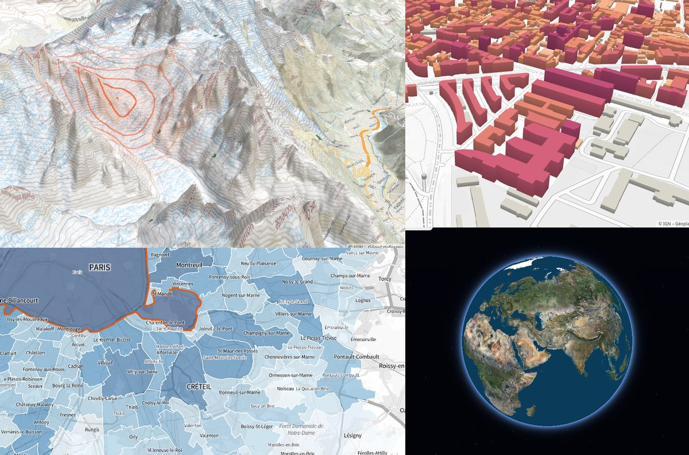
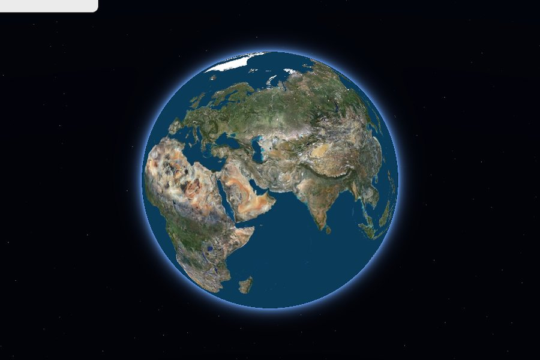
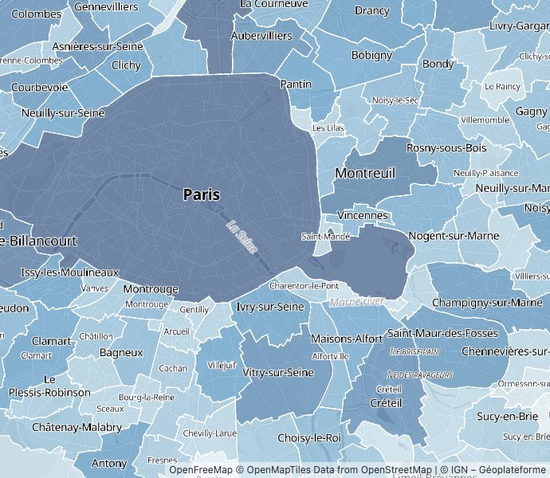
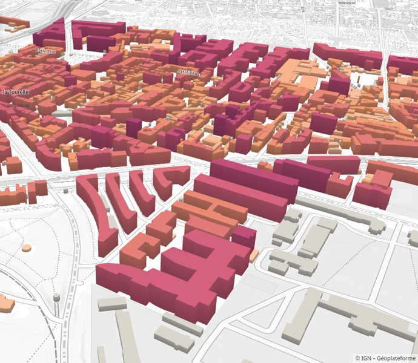
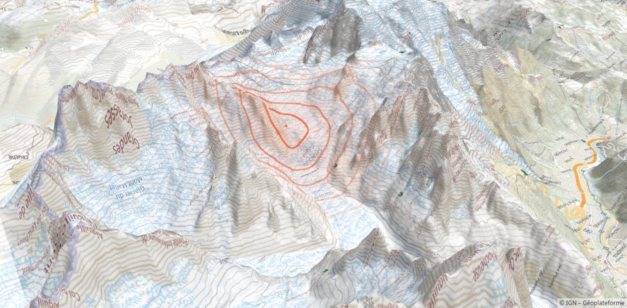
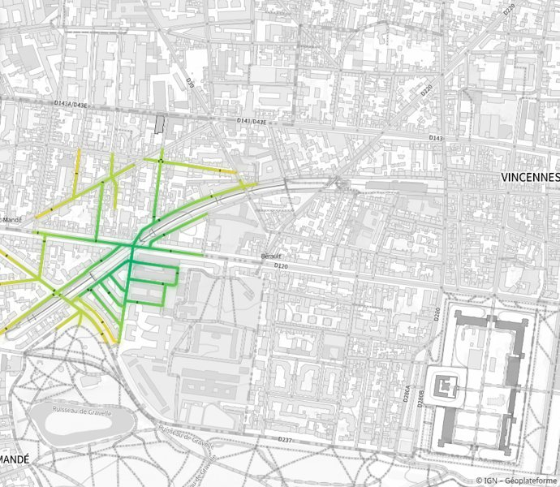
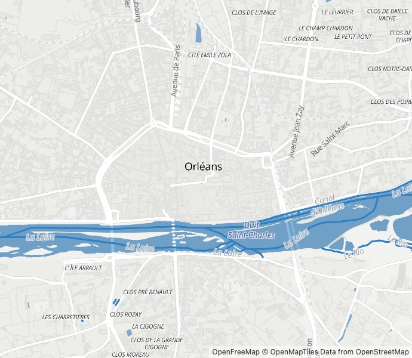
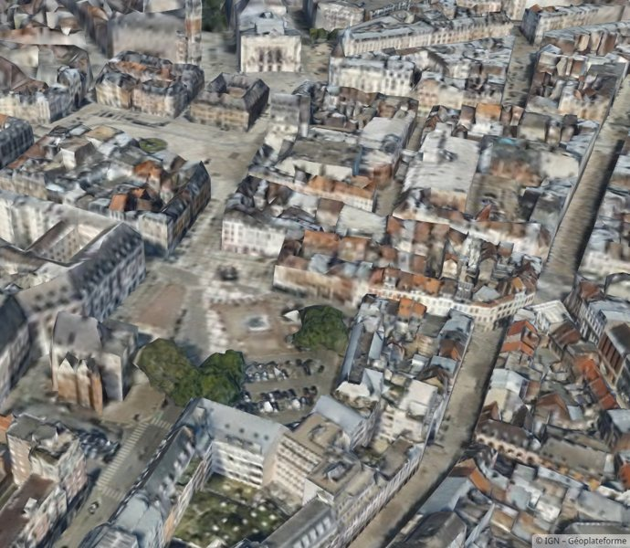
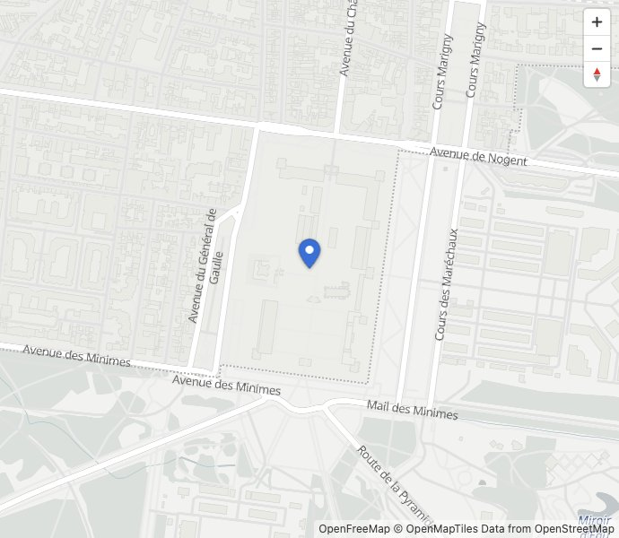
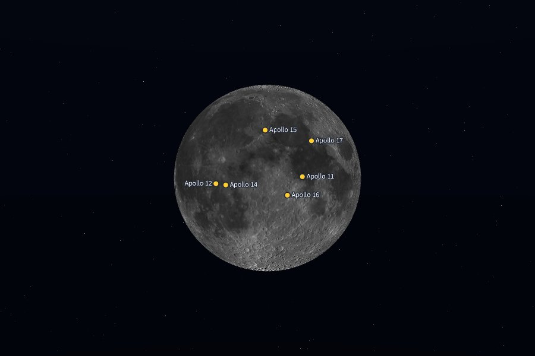

<div align="center">


# Isard

**Maps that recolor at every mouse move.**

A WebGL2 map engine for large, interactive data layers on Géoplateforme basemaps.<br />
Rust core in WebAssembly, a small TypeScript API.

[](https://www.npmjs.com/package/@ign-junn/isard)
[](https://graffkevin.github.io/isard/)
[](https://github.com/graffkevin/isard/actions/workflows/checks.yml)
[](LICENSE)

**[Documentation](https://graffkevin.github.io/isard/)** ·
**[Examples](https://graffkevin.github.io/isard/examples/)** ·
**[API](https://graffkevin.github.io/isard/api)** ·
**[Changelog](CHANGELOG.md)**



</div>

## Why Isard

General-purpose map libraries spend their time on things these maps do not need. Isard is built for maps where
**millions of features change at every mouse move**: accessibility, flooding, flows.

- ⚡ **One upload, millions of features.** A network of 2 million street pieces recolors from a single texture upload
  of 4 bytes per node, drawn in the very frame of the mouse move; only the squares in view are drawn.
- 🗺️ **Géoplateforme basemaps.** PLAN.IGN raster or vector (its MapLibre styles drawn in workers, the labels above your
  data), orthophotos, hillshade, the IGN relief, on a globe that turns into Web Mercator.
- ⛰️ **Everything on the relief.** Lines, circles, labels and buildings stand on the ground; fills of any size are
  exact to the pixel over hills and valleys; your own GLSL is drawn over the ground like the basemap.
- 🏙️ **Buildings and 3D Tiles.** Buildings colored by a value or by a network's travel times, photomeshes and city
  models in 3D Tiles (Draco, meshopt, KTX2).
- 🦀 **Small and exact.** 220 KB of WebAssembly gzipped (330 KB once a 3D Tiles layer is added), f64 on the CPU and f32 relative to the camera on the GPU
  (centimetres at any zoom), frames on demand only, strict TypeScript types end to end.

## Quick start

```sh
bun add @ign-junn/isard     # or npm install @ign-junn/isard
```

```ts
import { GeoMap } from '@ign-junn/isard';

const map = await GeoMap.create(container, { center: [2.4246, 48.8457], zoom: 14, basemap: 'plan-grey-vector' });
const network = map.addNetwork({ nodes, edges, max: 1800 }); // lon/lat pairs, node index pairs
map.on('hover', ({ lonLat }) => lonLat && network.setValues(travelTimes(lonLat))); // one value per node
```

That is the whole integration: the map fills its container, follows its size, handles mouse and touch and loads the
basemap. With a bundler, see [Getting started](https://graffkevin.github.io/isard/guide/getting-started#with-a-bundler).

## Examples

Live in the [documentation](https://graffkevin.github.io/isard/examples/), sources in [`examples/`](examples/).

<table>
  <tr>
    <td width="33%"><a href="https://graffkevin.github.io/isard/examples/globe"></a><br /><b>The globe</b><br />turning in its atmosphere, a flight to a click</td>
    <td width="33%"><a href="https://graffkevin.github.io/isard/examples/geojson"></a><br /><b>GeoJSON layers</b><br />fills by value, outlines, labels, picking</td>
    <td width="33%"><a href="https://graffkevin.github.io/isard/examples/buildings"></a><br /><b>Buildings</b><br />raised to their height, colored by it</td>
  </tr>
  <tr>
    <td><a href="https://graffkevin.github.io/isard/examples/relief"></a><br /><b>Relief and a ground shader</b><br />your GLSL over the mountains</td>
    <td><a href="https://graffkevin.github.io/isard/examples/network"></a><br /><b>Travel times on hover</b><br />a network recolored at every move</td>
    <td><a href="https://graffkevin.github.io/isard/examples/vector"></a><br /><b>Vector basemaps</b><br />the PLAN.IGN styles, a restyled subset</td>
  </tr>
  <tr>
    <td><a href="https://graffkevin.github.io/isard/examples/tiles3d"></a><br /><b>3D Tiles</b><br />the Lille photomesh</td>
    <td><a href="https://graffkevin.github.io/isard/examples/basic"></a><br /><b>A map</b><br />the vector basemap, a marker and its popup</td>
    <td><a href="https://graffkevin.github.io/isard/examples/moon"></a><br /><b>The Moon</b><br />another body, the LRO mosaic, the Apollo sites</td>
  </tr>
</table>

## What it draws

| Layer | | |
|---|---|---|
| [Networks](https://graffkevin.github.io/isard/layers/networks) | `addNetwork` | millions of edges colored by a value per node, worked out per pixel along the edges |
| [Lines, circles, fills](https://graffkevin.github.io/isard/layers/features) | `addLines`, `addCircles`, `addFills` | GeoJSON styled per feature: zoom stops, functions, values through a ramp, filters |
| [Labels](https://graffkevin.github.io/isard/layers/labels) | `addSymbols` | Géoplateforme fonts, halos, along lines, collisions shared by all layers |
| [Buildings](https://graffkevin.github.io/isard/layers/buildings) | `addExtrusions` | tiles or one set, colored by values or by a network's times |
| [Ground shaders](https://graffkevin.github.io/isard/layers/ground) | `addGround` | your fragment shader over the ground: water depth, heat maps |
| [Rasters](https://graffkevin.github.io/isard/layers/rasters) | `addRaster` | XYZ, WMTS, WMS, or tiles drawn by your code |
| [3D Tiles](https://graffkevin.github.io/isard/layers/tiles3d) | `addTiles3d` | b3dm, glb, external tilesets, compressed or not |

Plus markers, popups, controls, picking within a radius, `easeTo`, `flyTo`, a sky and fog for tilted views. All in
the [API reference](https://graffkevin.github.io/isard/api).

## Fast by design

Geometry uploaded once and only the view drawn, values in textures, the ground composited in one pass, frames on
demand, decoding and vector tiles in workers. The details and the measures:
[Performance](https://graffkevin.github.io/isard/guide/performance).

## Develop

Rust (with `wasm32-unknown-unknown` and `wasm-bindgen-cli` 0.2.129) and Bun:

```sh
bun install
bun run dev        # the demo on http://127.0.0.1:5180, the examples on /examples/, the benchmark on /bench/
bun run test       # Rust tests
bun run lint       # Biome, clippy pedantic (native and wasm)
bun run typecheck  # strict TypeScript
bun run docs:dev   # the documentation, with the examples live
```

The root holds two workspaces side by side: Rust (`Cargo.toml`) and TypeScript (`package.json`), and `bun run build`
drives both.

```
crates/geo/        camera, projections, geodesy and geoid, tile selection, label placement, polygons   tested natively
crates/tiles3d/    3D Tiles tree, traversal and decoding                                                tested natively
crates/engine/     the WebAssembly core: the engine, the ground, the layers, picking
packages/isard/    the npm package @ign-junn/isard: GeoMap, layer handles, overlays, workers
apps/              the demo and the benchmark (Isard, iTowns, 3DTilesRendererJS)
examples/          one page per example
docs/              the documentation site (VitePress)
scripts/           build, dev server, docs, release
```

More in [Develop and release](https://graffkevin.github.io/isard/guide/develop).

## Roadmap

- Flood maps over the relief (water depth as a ground shader) as a full example.
- Icons of the basemaps' symbol layers (sprites), text along curved lines.
- Labels fading in and out instead of popping.

## Licence

MIT, © Institut national de l'information géographique et forestière (IGN).
